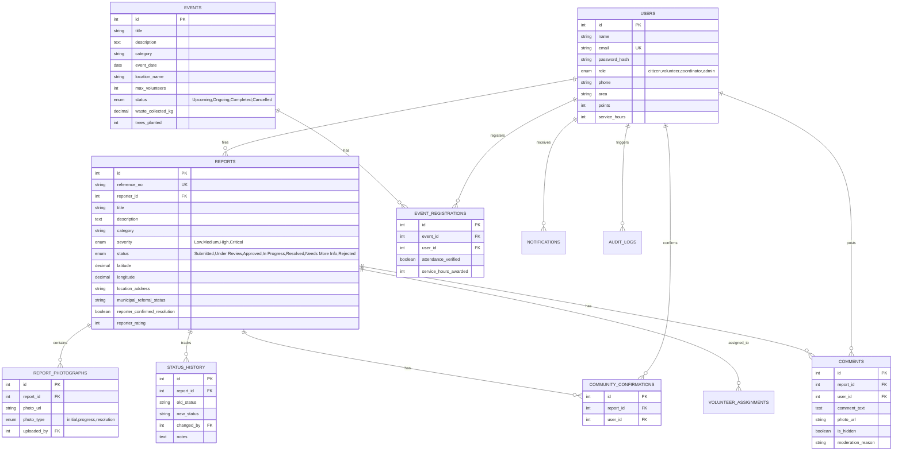
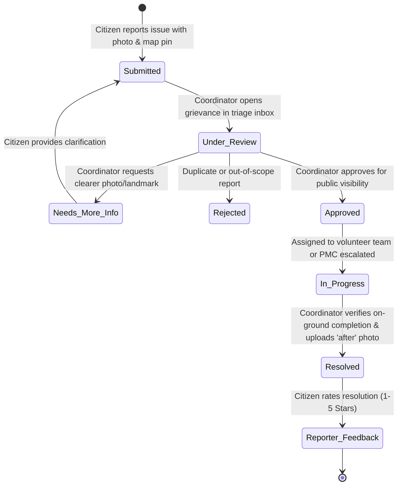
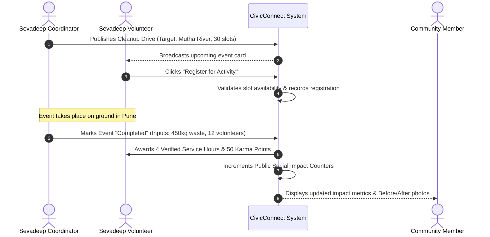

# Sevadeep CivicConnect: Complete Project Documentation & Technical Architecture

> **Platform:** Sevadeep CivicConnect  
> **Client / Organization:** Sevadeep NGO, Pune, Maharashtra, India  
> **Tagline:** *"Your Community. Your Voice. Together, We Create Change."*  
> **Date:** October 2026  
> **Version:** 1.0.0 Production-Ready Release  

---

## Table of Contents
1. [Executive Summary & What Has Been Done](#1-executive-summary--what-has-been-done)
2. [How It Is Done: Architecture & Implementation](#2-how-it-is-done-architecture--implementation)
3. [Complete Technology Stack & Tooling](#3-complete-technology-stack--tooling)
4. [Database Design & Relational Schema (11 Tables)](#4-database-design--relational-schema)
5. [End-to-End System Flows & Architecture Diagrams](#5-end-to-end-system-flows--architecture-diagrams)
6. [Feature Catalog & Step-by-Step Execution Guide](#6-feature-catalog--step-by-step-execution-guide)
7. [Novelty & Distinctive Innovations](#7-novelty--distinctive-innovations)
8. [Project Scope (Current & Future Expansion)](#8-project-scope-current--future-expansion)
9. [Social & Environmental Impact Analysis](#9-social--environmental-impact-analysis)
10. [Local Setup, Configuration & Deployment Guide](#10-local-setup-configuration--deployment-guide)

---

## 1. Executive Summary & What Has Been Done

**Sevadeep CivicConnect** is a full-stack, enterprise-grade civic reporting, community engagement, and environmental mobilization web platform engineered specifically for **Sevadeep NGO** in Pune, Maharashtra.

While traditional NGO websites function merely as static digital brochures and government grievance portals often suffer from lack of transparency and citizen disengagement, **Sevadeep CivicConnect bridges the gap between active citizen reporting, community volunteerism, coordinator triage, and municipal escalation**.

### Key Deliverables Completed:
1. **Full-Stack Application Development**:
   - High-performance, modern frontend built with **React 18, Vite, and Tailwind CSS**.
   - Modular RESTful backend built with **Node.js, Express, and JWT Authentication**.
   - Relational database schema implemented on **MySQL 8.0** with 11 interlinked tables, strict referential integrity, and automated foreign key cascades.
2. **Citizen Civic Reporting Pipeline**:
   - Location-aware issue reporting with an interactive **Leaflet / OpenStreetMap pin picker** centered on Pune coordinates (`[18.5204, 73.8567]`).
   - Image upload pipeline with strict file type checks and 5 MB size enforcement via Multer.
   - Algorithmic generation of unique human-readable tracking identifiers: `SVD-2026-XXXX`.
3. **Privacy-Preserving Public Map & Gallery**:
   - Non-public triage queue: reported issues remain hidden until Sevadeep staff approves them.
   - Public view sanitization: sensitive personal contact details (phone numbers, full names, precise residential addresses) are never exposed on public cards or markers.
   - Interactive OpenStreetMap clustering with custom status badges (Approved, In Progress, Resolved).
4. **Three-Tier Role-Based Access Control (RBAC)**:
   - **Community Member (Citizen)**: Report grievances, upvote/confirm neighbor reports, comment, participate in events, and provide post-resolution verification feedback.
   - **Sevadeep Volunteer**: Browse cleanup and plantation events, register for slots, view assigned civic work, record service hours, and upload photographic progress evidence.
   - **Sevadeep Coordinator / Admin**: Comprehensive administrative dashboard, triage incoming grievances, assign volunteers, log Pune Municipal Corporation (PMC) docket numbers, moderate discussions, verify event outcomes, and audit platform activity.
5. **Two-Way Closed-Loop Resolution Workflow**:
   - Formal status progression: `Submitted` $\rightarrow$ `Under Review` $\rightarrow$ `Approved` $\rightarrow$ `In Progress` $\rightarrow$ `Resolved` (with branch states: `Needs More Information`, `Rejected`).
   - Mandatory coordinator sign-off: volunteer uploads do not automatically close an issue.
   - **Reporter Ground-Truth Verification**: The citizen who reported the problem provides a 1-to-5 star rating and confirms if the issue was satisfactorily addressed.
6. **Social Impact & Municipal Escalation Transparency**:
   - Real-time aggregation of environmental outcomes (kg of waste cleared, saplings planted, active volunteer hours).
   - Dedicated Pune Municipal Corporation (PMC) referral tracker displaying official escalation docket numbers for public works requiring municipal machinery.
7. **Interactive Before & After Split Slider**:
   - Interactive visual inspection component for resolved grievances allowing residents to drag a slider to inspect authentic site remediation.
8. **Proximity "Nearby Duplicate" Intake Alert**:
   - Client-side Haversine geospatial proximity engine calculating distance to existing open reports within 100 meters, consolidating neighbor upvotes and preventing triage fatigue.
9. **Official PMC Ward Escalation Notice & Statutory RTS SLA Watchdog**:
   - Real-time statutory SLA countdown tracker (7 days for waste, 15 days for infrastructure) under the **Maharashtra Right to Public Services Act (RTS Act), 2015**, generating formal printable escalation notices for Pune Ward Officers.
10. **Official Verified Volunteer Service Credential**:
    - Generates print-ready, tamper-evident digital service certificates recognizing verified volunteer field hours and impact points for academic credits and corporate CSR verification.
11. **WhatsApp 1-Click Community Mobilization**:
    - Pre-formatted one-click social sharing to local neighborhood and housing society WhatsApp groups to aggregate citizen confirmations.
12. **Bilingual Regional Accessibility (English ⇄ मराठी)**:
    - Zero-latency language switcher enabling local Pune citizens, street vendors, and ground sanitation volunteers to navigate the platform in Marathi.
13. **Chronic Black-Spot Hotspot Detection & Heat Layer**:
    - Automated spatial clustering identifying recurring waste dumping black spots within 250 meters, highlighting chronic zones on the OpenStreetMap interface with dashed heat perimeters.
14. **One-Click CSR & Donor Impact Disclosure Brief (Print/PDF)**:
    - Generates print-ready executive transparency disclosures aligned with UN SDG 11 (Sustainable Cities) and SDG 12 (Responsible Consumption) for corporate donors and municipal partners.

---

## 2. How It Is Done: Architecture & Implementation

The application adheres to a decoupled, multi-layered Client-Server architecture designed for scalability, security, and maintainability:

```
┌─────────────────────────────────────────────────────────────┐
│                 React 18 Single Page App (SPA)              │
│       Vite + Tailwind CSS + Leaflet OSM + Recharts          │
└──────────────────────────────┬──────────────────────────────┘
                               │ HTTPS / JSON REST API
                               │ Authorization: Bearer <JWT>
┌──────────────────────────────▼──────────────────────────────┐
│                    Express.js REST API                      │
│     CORS • Multer (Uploads) • JWT Guard • Rate Limiter      │
├──────────────────────────────┬──────────────────────────────┤
│  Controllers & Business Logic│  Auth, Issues, Events, Admin │
├──────────────────────────────┼──────────────────────────────┤
│  Data Access Layer           │  mysql2/promise Pool         │
└──────────────────────────────┬──────────────────────────────┘
                               │ SQL Queries & Transactions
┌──────────────────────────────▼──────────────────────────────┐
│                   MySQL 8.0 Database Engine                 │
│        11 Normalized Tables • Indexed Geo Coordinates       │
└─────────────────────────────────────────────────────────────┘
```

### Architectural Highlights:
- **Connection Pooling**: Backend leverages `mysql2/promise` connection pooling with automatic reconnection, keep-alives, and prepared statements preventing SQL injection attacks.
- **Stateless Authentication**: JSON Web Tokens (JWT) signed with a secure secret key, carrying claims (`id`, `email`, `role`) with an 8-hour expiry.
- **Strict Role-Guard Middleware (`requireRole`)**: Backend route decorators enforce authorization. Attempting to approve an issue or complete an event without the `coordinator` or `admin` role returns an immediate `403 Forbidden`.
- **Atomic Operations & Status Auditing**: Every status change atomically updates the `reports` table, inserts an immutable entry into `status_history`, and creates an in-app `notification` for the reporter.
- **Local Asset Serving**: Uploaded evidence photographs are stored in `server/uploads/` with sanitized timestamp-prefixed names and served statically via Express.

---

## 3. Complete Technology Stack & Tooling

| Layer | Technology | Version | Purpose & Rationale |
| :--- | :--- | :--- | :--- |
| **Frontend Framework** | **React** | 18.2.0 | Declarative UI component architecture with Hooks and React Context |
| **Build Tool** | **Vite** | 5.1.0 | Sub-millisecond Hot Module Replacement (HMR) and optimized rollup bundling |
| **Styling & Design** | **Tailwind CSS** | 3.4.1 | Utility-first responsive CSS framework with custom Sevadeep forest/emerald palette |
| **Icons** | **Lucide React** | 0.344.0 | Clean, accessible SVG iconography across all cards and navigation |
| **Geospatial Mapping** | **Leaflet & React-Leaflet**| 1.9.4 / 4.2.1 | Open-source OpenStreetMap integration without costly Google Maps API keys |
| **Data Visualization** | **Recharts** | 2.12.0 | SVG charting for grievance trends, category distribution, and impact stats |
| **Routing** | **React Router DOM**| 6.22.0 | Client-side routing, protected routes, and role-based redirects |
| **HTTP Client** | **Axios** | 1.6.7 | Promise-based HTTP client with request interceptors for automatic JWT injection |
| **Backend Runtime** | **Node.js** | 20.x LTS | High-concurrency event-driven JavaScript runtime |
| **Web Framework** | **Express.js** | 4.18.2 | Fast, unopinionated routing engine and middleware stack |
| **Database** | **MySQL Server** | 8.0 | ACID-compliant relational database for structured civic records and relationships |
| **DB Driver** | **mysql2** | 3.9.1 | High-performance MySQL client supporting prepared statements and promises |
| **Authentication** | **jsonwebtoken** | 9.0.2 | Signed cryptographic tokens for stateless user sessions |
| **Password Hashing** | **bcryptjs** | 2.4.3 | Blowfish cipher salt-hashing (10 rounds) protecting user passwords |
| **File Uploads** | **Multer** | 1.4.5 | Multipart form-data parser with disk storage and MIME validation |

---

## 4. Database Design & Relational Schema

The database `sevadeep_civicconnect` contains **11 normalized relational tables**:



---

## 5. End-to-End System Flows & Architecture Diagrams

### 5.1 Issue Lifecycle State Machine



### 5.2 Community Volunteer Event Flow



---

## 6. Feature Catalog & Step-by-Step Execution Guide

### 6.1 Role Switcher Toolbar (Demonstration Suite)
At the top of every screen, an ambient Quick Demo Switcher bar is available for seamless evaluation:
- Click **"Citizen"** $\rightarrow$ Active session switches to `citizen@sevadeep.org` (Sunita Deshmukh).
- Click **"Volunteer"** $\rightarrow$ Active session switches to `volunteer@sevadeep.org` (Aarav Kulkarni).
- Click **"Coordinator"** $\rightarrow$ Active session switches to `coordinator@sevadeep.org` (Dr. Ananya Joshi).
- Click **"Admin"** $\rightarrow$ Active session switches to `admin@sevadeep.org` (Vikram Deshmukh).

---

### 6.2 Feature 1: Submitting a Community Report (Citizen Journey)
1. Ensure you are logged in as **Community Member**.
2. Click **"Report an Issue"** in the top navigation bar or the hero section.
3. Fill out the report form:
   - **Title**: e.g., *"Overflowing garbage bin near Sarasbaug Ganpati Mandir"*.
   - **Category**: Select *Garbage and Waste Management*.
   - **Severity**: Select *High*.
   - **Description**: Add contextual details.
   - **Photo Upload**: Attach a photograph of the issue.
   - **Location**: Click anywhere on the interactive Pune map or drag the pin to set the exact latitude/longitude. Address will auto-fill with Pune landmark suggestions.
4. Click **"Submit Community Report"**.
5. **Outcome**: A success screen appears displaying your unique reference number (e.g. `SVD-2026-0010`). The issue is marked `Submitted` and queued for coordinator review.

---

### 6.3 Feature 2: Coordinator Triage & Public Approval
1. Switch to **Coordinator** using the top demo bar.
2. Navigate to **Admin Dashboard** $\rightarrow$ **Incoming Triage** (`/admin/incoming`).
3. View the pending submission. You will see the photo, coordinates, and timestamp.
4. Click **"View & Triage"** to open the detail page.
5. In the **Coordinator Decision Panel** at the top right:
   - Change status to **`Approved (Public on Map)`**.
   - Select an assigned volunteer from the dropdown.
   - Click **"Save Status & Notify Reporter"**.
6. **Outcome**: The report is now approved and immediately rendered with an interactive pin on the public [Community Issues Map](http://localhost:5173/issues).

---

### 6.4 Feature 3: Community Confirmation & Discussion
1. Switch to **Citizen** or browse as a public guest.
2. Navigate to [Community Issues](http://localhost:5173/issues) and click on the newly approved issue.
3. Click the **"Support / Confirm This Issue"** button:
   - The confirmation counter increments by 1.
   - The database prevents duplicate confirmations from the same user account.
4. Scroll to the **Community Discussion** section:
   - Post an update comment with an optional photo.
   - If a coordinator views the comment, they have a one-click **Moderate / Hide Comment** button to protect community safety.

---

### 6.5 Feature 4: Resolving an Issue & Ground-Truth Citizen Verification
1. Switch to **Coordinator**.
2. Open the issue page (`/issues/:id`).
3. In the **Coordinator Decision Panel**:
   - Set status to **`Resolved (Outcome Verified) ✅`**.
   - Enter **Coordinator Resolution Notes** (e.g., *"Sevadeep volunteer team cleaned the site and PMC cleared the container"*).
   - Upload an **"After" Photo Proof** showing the clean area.
   - Click **"Save Status & Notify Reporter"**.
4. Switch back to **Citizen** (the original reporter).
5. Refresh the page:
   - The prominent **Reporter Resolution Feedback** widget appears.
   - Select: *"Yes, problem is resolved satisfactorily"*.
   - Select **5 Stars** rating.
   - Type feedback: *"Great work by the Sevadeep team! The sidewalk is clean."*
   - Click **"Submit Reporter Verification"**.

---

### 6.6 Feature 5: Volunteer Event Registration & Impact Completion
1. Switch to **Volunteer**.
2. Navigate to [Volunteer Activities](http://localhost:5173/activities).
3. Find an upcoming event (e.g., *"Mutha Riverbank Cleanup Drive"*).
4. Click **"Register as Volunteer"**. Your spot is secured, and slot availability updates in real time.
5. Switch to **Coordinator** and navigate to [Admin Activities](http://localhost:5173/admin/activities).
6. Click **"Mark Completed & Log Impact"** on the event:
   - Enter **Waste Collected**: `520` kg.
   - Enter **Trees Planted**: `40`.
   - Enter **Completion Summary**.
7. Click **"Save & Finalize Event"**.
8. Navigate to the public [Social Impact & Transparency Page](http://localhost:5173/impact) to see the numbers update live!

---

### 6.7 Feature 6: Interactive Before & After Visual Inspection
1. Navigate to any resolved issue (e.g., `/issues/1` or `/issues/2`).
2. In the **Verified Outcome & Resolution Summary** card, the interactive **Before & After Inspection Slider** is rendered.
3. Drag the center slider handle left and right:
   - The red **"⚠️ Before: Issue"** layer reveals the initial contaminated site.
   - The green **"✓ After: Resolved"** layer reveals the remediated, sanitized site.
4. Mobile-friendly touch drag ensures field coordinators and citizens can demonstrate authentic cleanup on mobile devices.

---

### 6.8 Feature 7: Proximity "Nearby Duplicate" Intake Alert
1. Navigate to [Report an Issue](http://localhost:5173/report).
2. Move the interactive map pin to an area with an existing open report (e.g. Swargate or Deccan).
3. The Haversine geospatial proximity engine checks within a 100-meter radius.
4. An amber alert immediately appears:
   - *"⚠️ Possible Duplicate Detected within ~45 meters! A neighbor has already reported: '[Title]' (SVD-2026-XXXX). View & Support Existing Report Instead →"*
5. Clicking the link allows the resident to upvote/confirm the existing issue instead of cluttering coordinator triage queues with duplicate tickets.

---

### 6.9 Feature 8: Municipal (PMC) RTS SLA Watchdog & Ward Escalation Notice
1. Open an issue with a logged `municipal_referral_status` or click **"PMC Ward Notice Draft"**.
2. An official notice modal opens displaying the statutory timeline under the **Maharashtra Right to Public Services Act (RTS Act) 2015**:
   - 7-day statutory deadline for solid waste / garbage clearance.
   - 15-day statutory deadline for road cavities, potholes, and broken water infrastructure.
3. The modal generates a formal legal notice addressed to the specific Pune Ward Officer (Ghole Road, Kothrud, Aundh-Baner, or Kasba-Vishrambaug) pre-filled with the docket number, coordinates, days elapsed, and statutory citation.
4. One-click buttons allow coordinators to **"Copy Notice"** or **"Print Formal Notice"** for official delivery.

---

### 6.10 Feature 9: Official Volunteer Service Credential Generation
1. Switch to **Volunteer** and navigate to [Volunteer Workspace](http://localhost:5173/volunteer/dashboard).
2. Click **"Generate Official Certificate"** in the top workspace hero.
3. A formal credential modal opens:
   - Displays the volunteer's name, verified service hours, and accumulated civic impact score.
   - Features official Sevadeep NGO registration credentials (`Mah/PNE/1029/2018`).
   - Includes authorized signatory sign-off from Chief Field Coordinator and Trustee.
4. Click **"Print / Download Certificate PDF"** to generate a landscape certificate for university NSS credits or corporate CSR appraisal.

---

### 6.11 Feature 10: WhatsApp 1-Click Community Mobilization
1. Open any public community report (`/issues/:id`).
2. Scroll to the bottom of the main card to find the **WhatsApp Mobilization Bar**.
3. Click **"💬 Share on WhatsApp"**:
   - Automatically opens WhatsApp with a pre-filled, localized alert message containing the issue title, street landmark, and live link.
   - Neighbors in local housing societies can click the link and immediately hit "Support / Confirm" to escalate priority.

---

### 6.12 Feature 11: Bilingual Regional Language Switcher (English ⇄ मराठी)
1. On the top navigation bar, click the **"मराठी / English"** pill toggle.
2. The entire navigation, primary action buttons, status labels, and core headings instantly translate into Marathi (`तक्रार नोंदवा`, `परिसरातील समस्या`, `स्वयंसेवक उपक्रम`, `सामाजिक प्रभाव`).
3. Persistent language preference is saved to `localStorage` for returning visits.

---

### 6.13 Feature 12: Chronic Black-Spot Hotspot Detection Layer
1. Navigate to [Community Issues](http://localhost:5173/issues).
2. On the top-left of the interactive Leaflet map, click **"Detect Chronic Black-Spots"**.
3. The spatial clustering engine scans all issues within 250-meter zones:
   - Pulsing crimson dashed perimeters encircle recurring dumping points (e.g. Swargate Mandai or FC Road).
   - Hotspot pins are badged with a flame icon (`🔥`).
   - Clicking a hotspot reveals how many recurring complaints have emerged in that specific zone, providing empirical proof for Sevadeep to advocate for municipal CCTV cameras and permanent waste containers.

---

### 6.14 Feature 13: One-Click CSR & Donor Impact Brief Export (PDF)
1. Navigate to [Social Impact & Transparency](http://localhost:5173/impact).
2. Click the prominent **"Download Official CSR & Donor Impact Brief (PDF)"** button.
3. A formal executive disclosure document opens:
   - Features UN Sustainable Development Goals (SDG 11 & SDG 12) alignment.
   - Aggregates empirical kilograms of waste diverted, trees planted, and volunteer hours.
   - Summarizes ward-level operations across Pune.
4. Click **"Print / Download PDF"** to produce an executive document for corporate CSR review and grant applications.

---

## 7. Novelty & Distinctive Innovations

| # | Traditional Civic / NGO Websites | Sevadeep CivicConnect Innovation | Why It Matters |
| :---: | :--- | :--- | :--- |
| **1** | **Unilateral Mark-as-Done**<br>Authorities mark tickets resolved without resident confirmation. | **Dual Ground-Truth Verification Loop**<br>Only coordinator can mark resolved, but the original citizen reporter must verify on-ground reality with a 1–5 star rating. | Eliminates false resolutions and builds deep trust between residents and the NGO. |
| **2** | **Static Brochureware**<br>Annual reports PDF published once a year. | **Live Real-Time Impact Telemetry**<br>Real database aggregation of kg waste collected, trees planted, and volunteer hours. | Complete transparency for donors, citizens, and municipal partners. |
| **3** | **Black-Box Municipal Blame**<br>Civic issues outside NGO scope are discarded or ignored. | **Formal Municipal (PMC) Escalation Bridge & RTS SLA Watchdog**<br>Statutory countdown timer (7/15 days) and auto-generated formal legal notices under Maharashtra RTS Act 2015. | Honest civic advocacy with statutory legal standing. |
| **4** | **Static Photo Proof**<br>Single blurry resolution photo easily falsified. | **Interactive Before & After Split Slider**<br>Draggable split-screen comparison verifying physical transformation. | Indisputable visual transparency for citizens and evaluators. |
| **5** | **Triage Duplicate Floods**<br>Coordinators drown in 30 tickets for the same pothole or bin. | **Proximity Duplicate Detection (<100m)**<br>Haversine radius engine prompts neighbors to upvote existing tickets instead of creating duplicates. | Prevents triage fatigue and consolidates neighborhood collective action. |
| **6** | **Uncredited Volunteering**<br>Volunteer hours locked inside arbitrary in-app points. | **Verifiable Volunteer Service Credential**<br>Printable, official certificate with registration ID for college credits (SPPU/COEP) and corporate CSR appraisal. | Drastically increases volunteer retention and engagement. |
| **7** | **Linguistic Exclusion**<br>English-only civic tech leaves out grassroots workers and citizens. | **Instant Bilingual (English ⇄ मराठी) Engine**<br>Seamless toggle into Marathi tailored for Pune residents and sanitation field workers. | Bridges the digital divide for local community empowerment. |
| **8** | **Recurring Spot Relapse**<br>Cleaned spots become dumpsites again within 48 hours. | **Chronic Black-Spot Hotspot Detection Layer**<br>Spatial clustering highlights chronic dumping zones on Leaflet maps to advocate for municipal bins and CCTV. | Shifts focus from reactive cleanups to root-cause civic infrastructure. |
| **9** | **Manual Donor Reporting**<br>NGO staff spends weeks compiling CSR reports. | **One-Click CSR & Donor Impact Brief Generator**<br>Instant print-ready disclosure aligned with UN SDG 11 & 12 with live telemetry. | Simplifies corporate fundraising and municipal grant compliance. |

---

## 8. Project Scope (Current & Future Expansion)

### Current Operational Scope:
- **Geographic Focus**: Pune Metropolitan Area (Shivajinagar, Swargate, Kothrud, Deccan Gymkhana, Mandai, Vetal Tekdi, Kasba Peth, Hadapsar).
- **Core Domain**: Solid waste management, illegal dumping, public hygiene, public parks, water leakage, and tree plantation.
- **Capacity**: Handles hundreds of concurrent reports, high-resolution photo uploads, and real-time mapping.

### Scalability & Future Roadmap:
1. **WhatsApp Bot Integration**: Reporting via WhatsApp Business API where citizens can send a picture and WhatsApp location pin to auto-create a ticket.
2. **AI Image Quality & Duplicate Detection**: Computer vision model to classify garbage volume and flag duplicate reports within a 50-meter radius.
3. **Automated PMC API Integration**: Direct API integration with Pune Municipal Corporation's `Pune Connect` grievance portal for automated docket exchange.
4. **Offline PWA Support**: Progressive Web App caching allowing field volunteers to record activity in low-connectivity areas like hill trails (Tekdis).

---

## 9. Social & Environmental Impact Analysis

Sevadeep CivicConnect transforms passive complaints into structured community action:

1. **Environmental Restoration**:
   - By aggregating cleanup drives into verifiable weight metrics (kg of plastic and municipal solid waste removed), the NGO provides empirical data to environmental researchers and municipal bodies.
2. **Civic Consciousness & Ownership**:
   - The upvote/confirmation mechanism allows neighborhoods to show collective solidarity, prioritizing chronic sanitation black-spots over minor isolated issues.
3. **Volunteer Recognition & Retention**:
   - Volunteers earn verified service hours and karma badges, which can be certified by Sevadeep for academic requirements, corporate CSR participation, and civic recognition.
4. **Data-Driven Governance**:
   - Heatmap patterns highlight chronic waste dumping zones, empowering Sevadeep to advocate for additional municipal dustbins and surveillance cameras with local Ward Officers.

---

## 10. Local Setup, Configuration & Deployment Guide

### Prerequisites:
- **Node.js** v18+ or v20+ LTS
- **MySQL Server** 8.0 running locally on port `3306`

### Server Configuration (`server/.env`):
```env
PORT=5000
DB_HOST=localhost
DB_PORT=3306
DB_USER=root
DB_PASSWORD=YourPasswordHere
DB_NAME=sevadeep_civicconnect
JWT_SECRET=sevadeep_civicconnect_secure_jwt_secret_key_2026_pune
```

### Initializing Database:
```powershell
cd server
node config/initDb.js
node config/seed.js
```

### Starting the Application:
```powershell
# In terminal 1 (Backend API):
cd server
npm run dev
# Running on http://localhost:5000

# In terminal 2 (Frontend Client):
cd client
npm run dev
# Running on http://localhost:5173
```

### Default Accounts for Evaluation:
| Role | Email | Password |
| :--- | :--- | :--- |
| **Coordinator (Staff)** | `coordinator@sevadeep.org` | `Password@123` |
| **Administrator** | `admin@sevadeep.org` | `Password@123` |
| **Volunteer** | `volunteer@sevadeep.org` | `Password@123` |
| **Community Member** | `citizen@sevadeep.org` | `Password@123` |

---
*Documentation compiled and verified for Sevadeep NGO, Pune.*
